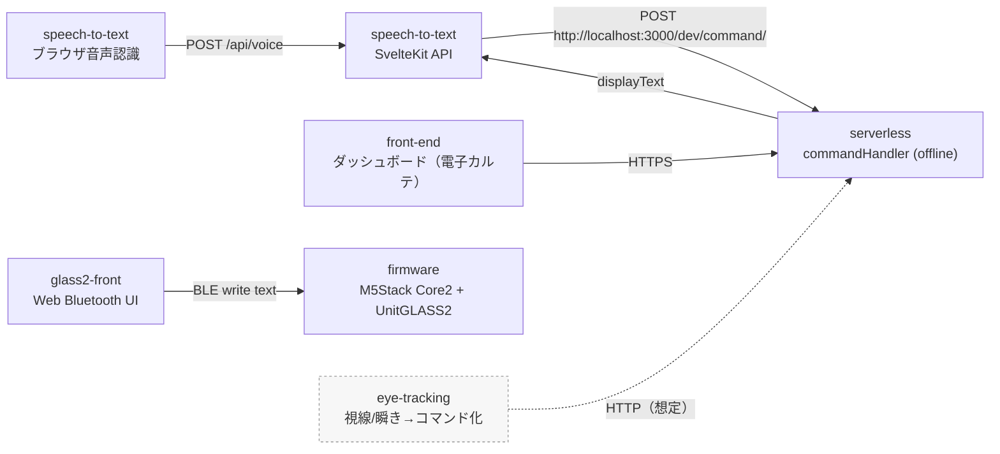

# 202508sp 組織ドキュメント（わたり方）

このドキュメントは、GitHub 組織 [202508sp](https://github.com/202508sp) にある各リポジトリの説明をまとめたものです。

## プロジェクト概要

- [介護用メモシステム「あいメモ」概要](project/ai-memo.md)

## 全体像

- `speech-to-text` はブラウザの音声認識（Web Speech API）で文字化し、ローカルの `serverless`（offline）に投げています。
- `serverless` はコマンド解析→コマンド実行→ `displayText` を返します。
- `glass2-front` は Web Bluetooth で BLE 接続し、テキストを `firmware` 側へ送ります。
- `eye-tracking` は別系統（ESP-EYE の映像→OpenCV）で視線コマンド化するプロジェクトです。

## リポジトリ早見表

| リポジトリ | 役割 | リンク | 主な技術 |
|---|---|---|---|
| `.github` | 組織プロフィール / 共通メタ | [詳細](repositories/.github.md)  | - |
| `docs` | 本ドキュメント置き場 | [詳細](repositories/docs.md) | Bun / textlint |
| `serverless` | API + インフラ（ローカルは offline） | [詳細](repositories/serverless.md) | Serverless / AWS / TS |
| `speech-to-text` | 音声→テキスト→API呼び出し（ローカル） | [詳細](repositories/speech-to-text.md) | SvelteKit |
| `glass2-front` | BLE送信UI（ブラウザ） | [詳細](repositories/glass2-front.md) | SvelteKit / Web Bluetooth |
| `firmware` | M5Stack Core2 + GLASS2 のBLE受信表示 | [詳細](repositories/firmware.md) | Arduino / ESP32 BLE |
| `front-end` | システムのフロント（本番想定） | [詳細](repositories/front-end.md) | SvelteKit / Firebase |
| `eye-tracking` | ESP-EYE→OpenCV→視線コマンド | [詳細](repositories/eye-tracking.md) | C++ / OpenCV |

## 動かすときの注意

- Web Bluetooth は対応ブラウザが限られます（Chromium 系推奨）。
- `speech-to-text` の Web Speech API はブラウザ依存で挙動差があります。
- `serverless` は AWS 系の設定（環境変数や資格情報）次第でローカルでも失敗します。
  - まずは `serverless-offline` + モック（開発/テスト）で動かして、I/O を固めます。
