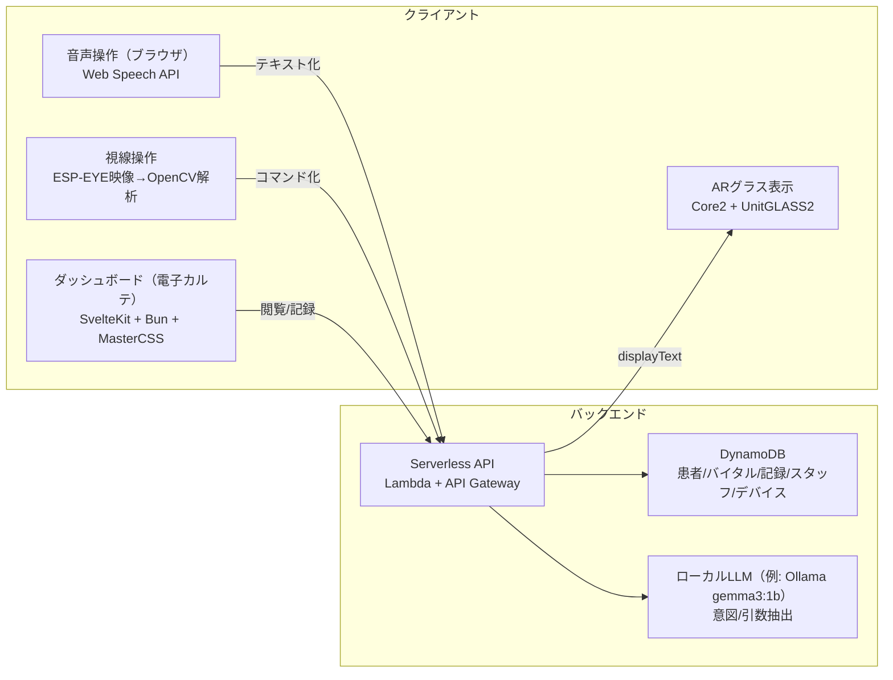

# プロジェクト概要: 介護用メモシステム「あいメモ」

このページは、202508sp 組織リポジトリ群の「何を作っているか」「どんな機能があるか」を俯瞰できるようにまとめたものです。

- 目的: 介護施設の記録作業をフリーハンド化し、その場で効率的に記録できるようにする
- アプローチ: ARグラス + ダッシュボード + サーバーレス API を統合し、音声/視線で入力・閲覧を行う

## 全体構成

## ハードウェア

- 表示: 透過OLED（M5UnitGLASS2、128×128px）
- 制御: M5Stack Core2（ESP32、Wi‑Fi/BLE）
- 視線/瞬き: ESP‑EYE（内蔵カメラ/マイク）
- 光学: ミラーシールで反射して視野内に投影
- 取付: 眼鏡に固定するアタッチメント方式

## 主要な機能

### 音声操作
- Web Speech API（SpeechRecognition / webkitSpeechRecognition）で連続認識
- 3秒間の無音で停止し、認識テキストをバックエンドへ送信
- LLM で自然言語→コマンドに変換（意図と引数の抽出）

### 視線操作
- EAR法で瞬きを検出（閾値 0.25 として記載）
- 二重瞬きで操作モード ON/OFF
- 視線方向（上/下/左/右など）でコマンド実行

### 電子カルテ（ダッシュボード）
- 情報過多になりがちなUIを、最大2階層のネストに制限して単純化
- ドラッグ&ドロップでダッシュボードをカスタム
- お気に入り/アイコン収納など、必要情報の即時参照を重視

## セキュリティ・運用

- デバイスIDを用いた認証/登録チェック（未登録デバイスの拒否）
- API は HTTPS 前提（API Gateway）
- ログ（例: CloudWatch Logs）で追跡可能な構成
